# Lane race runner

> **About this repository.** This README and the code were generated with AI. It is a scrubbed version of the race harness we used: the structure, mechanisms and lessons are kept; event data, solver knowledge and credentials are not. Treat it as inspiration rather than a drop-in tool. If you like an idea here, have your own AI adopt it into your setup.

The framework I used for the Huntress month long CTF (2nd Place Finish): each day unlocks one challenge per lane, with `single`, `time_trial` and `mastery` modes, and the score that matters is how fast the slowest lane finishes.

**Python drives. Claude fixes.** The runner does all of the routine work (wait for the unlock, download, solve, submit, move to the next mode) and parks any mode it cannot finish. A small number of Claude sessions (2 by default) each watch a balanced set of lanes on a shared status board, and fix parked modes by dropping in a plugin or a pin. The runner notices, re-runs offline and resubmits; the fixer never drives the race.

This repository is the framework only. Lane solvers start empty (the generic lane answers nothing) and grow from the fixes you write.

<picture>
  <source media="(prefers-color-scheme: dark)" srcset="docs/img/architecture-dark.svg">
  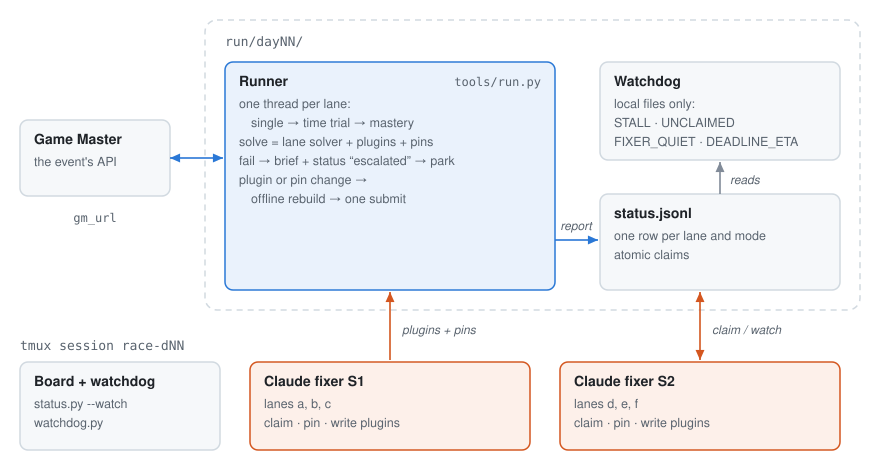
</picture>

## How lanes are split across sessions

By default (`session_split = "core_target"`) one session takes every core lane and a second session takes the live-target lanes (`target_lanes`, i.e. web):

```
S1: warm, meta, script, mobile, bin
S2: web
```

With `session_split = "weight"`, lanes are split longest-job-first by weight (`[lanes]` in config) over `sessions` sessions: the heaviest lanes go to different sessions first, and light lanes fill in. A session with nothing to do may take another session's row once it has sat unclaimed for `steal_after_s`, or when that session already holds two open rows (`tools/sessions.py --steal SN`). Claims are atomic.

## Layout

| Path | What it is |
| - | - |
| `launch.py` | the one entry point: split, runner, tmux, fixer sessions |
| `race/config.py` | every setting (config.toml or `RACE_*` env); nothing event-specific is built in |
| `race/gm.py` | Game Master client: shared pacing, 429 lockout, deadlines, record/replay, regular pool by default |
| `race/runner.py` | the driver: unlock, per-lane modes, escalation briefs, park and hot re-run |
| `race/status.py` | the shared board: append-only, one row per lane and mode, atomic claims |
| `race/plugins.py` | plugin loader: sorted, fill-blank by default, masking that every path honours |
| `race/pins.py` | per-mode hand-solved answers, atomic merges |
| `race/lanes/` | the lane interface, safe artifact extraction, a toy example solver |
| `race/watchdog.py` | stall, unclaimed, quiet-fixer and deadline alerts (local files only) |
| `race/sessions.py` | lane split and work stealing |
| `race/replay.py` | offline rebuild + grade of any recorded mode |
| `tools/` | CLIs: `status`, `pin`, `verify_plugin`, `replay`, `gm`, `sessions`, `watchdog`, `run`, `new_skill`, `scrub_check` |
| `docs/FIXER.md` | the protocol every Claude session follows |
| `docs/LANES.md` | how to add lane solvers and plugins |
| `.claude/skills/lane-<lane>/` | one empty Claude skill per lane (recipes, commands, traps); `tools/new_skill.py` adds one |
| `docs/SKILL_TEMPLATE.md` | the template those skills start from |
| `tests/` | unit tests, end-to-end race against `mock_gm.py` |


## Design rules

- **One row per lane and mode.** Fixers get a brief with every wrong and missing key, not a stream of keys.

- **Blank keys escalate before any submit.** An unknown answer is a real problem; a guess wastes a try.

- **A plugin fixes every mode, a pin fixes one.** Pin what you know at once, then write the plugin before the next mode starts (the runner prints `PLUGIN_FIRST` to say so).

- **Fixers never re-run anything live.** Writing a plugin or pin is the interface; the runner rebuilds offline from the saved members and submits once to the same attempt.

- **Takeover beats tinkering.** Same key wrong after two plugin installs, five minutes, or no explanation in two: hand-solve and pin.

- **Offline checks must hide what the morning didn't have.** Replays mask plugins through one loader that every helper uses, and they print the grade line first.

- **One pacer for the whole machine.** Runner, fixers and hand-run tools share the request budget and the 429 lockout.

- **Ranked clocks are opt-in.** Everything defaults to the regular pool; nothing restarts an attempt.

- **Artifacts are untrusted.** Safe extraction with a size budget, nothing executed, `python3 -I` everywhere.

- **Every script's `--help` is safe**, unknown flags stop before anything starts, and `launch.py` is idempotent.

## How it runs, with lessons from a real race

Section 1 is the final day of a real race, kept as recorded. Sections 2–6 describe the same mechanisms in this framework's terms.

### 1 · Final day, second by second

<picture>
  <source media="(prefers-color-scheme: dark)" srcset="docs/img/final-day-dark.svg">
  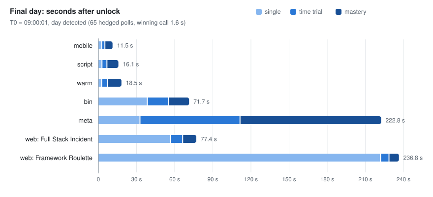
</picture>

| Lane | single | time trial | mastery | note |
| - | - | - | - | - |
| mobile | 2.6 s | 5.1 s | 11.5 s | no hand work |
| script | 2.8 s | 6.7 s | 16.1 s | no hand work |
| warm | 2.6 s | 7.0 s | 18.5 s | no hand work |
| bin | 38.5 s | 55.2 s | 71.7 s | one blank key pinned at 38.5 s, then a plugin |
| meta | 32.7 s | 111.4 s | 222.8 s | plugin rule guessed wrong: mastery 11/15 sets wrong |
| web: Full Stack Incident | 56.7 s | 66.3 s | 77.4 s | today's chained incident, plugin written live |
| web: Framework Roulette | 222.0 s | 228.6 s | 236.8 s | single took 222 s: the admin header was named only in the Vary response header; two plugin tries missed first (36 s, 85 s): the policy page said staff\_only, but the header wanted administrator |


All six lanes start in the same second. Each lane runs its own chain (single, then time trial, then mastery), so a slow lane never holds up a fast one. Three lanes were done before most people could have opened the first artifact. The day's total is set by the slowest lane: meta, where a plugin's guessed rule passed single and time trial by luck and failed mastery.

**Look for:** the three short bars at the top. That is the cold path, with no agent involved. The long bars are where the remaining time goes: writing a plugin live for a format nobody had seen.

`blitz.py:1288 · run_lane` — each lane runs single → time trial → mastery on its own, then parks if anything is left

```
def run_lane(lane, cid, args):
    # ...
    try:
        if not args["timed_only"]:
            rep, merged = single(lane, gm, cid, args["dry"])
        # ...
        if (rep.get("result") in OK or args["timed_only"]) and not (args["dry"] or args["no_timed"]):
            # ...
            rep["time_trial"] = timed(lane, cid, "time_trial", gm)
            recover(lane, cid, "time_trial", rep)
            if mastery_gated(rep):
                rep["mastery"] = gated_mastery(lane)
            else:
                rep["mastery"] = timed(lane, cid, "mastery", gm)
    # ...
    if not args["dry"] and not all_done(rep, args) and PARK_S > 0:
        park(lane, cid, rep, args, gm, stamp0)
```

`blitz.py:1685 · main` — one thread per lane, so a slow lane never holds up a fast one

```
    with ThreadPoolExecutor(len(cids) or 1) as ex:
        futs = {lane: ex.submit(run_lane, lane, cid, args) for lane, cid in cids.items()}
        reps = {lane: f.result() for lane, f in futs.items()}
```

### 2 · Who talks to whom on race morning

<picture>
  <source media="(prefers-color-scheme: dark)" srcset="docs/img/race-morning-dark.svg">
  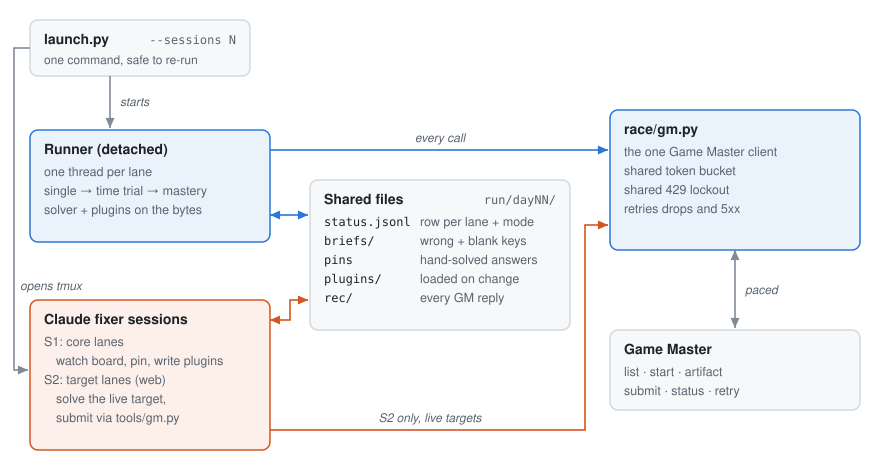
</picture>

`session_split = "core_target"` (default) gives S1 every core lane and S2 the target lanes. If one session juggling several lanes is too much overhead, use `session_split = "weight"` with `--sessions N` so each core lane can have its own session. Nothing calls the Game Master directly: the runner, the fixers and anything run by hand go through one client that shares the request budget across processes. Fixers never re-run the race; they drop a pin or a plugin into the shared files, and the runner notices and re-runs the lane.

`race/gm.py` — one token bucket and one lockout for every process

```
    def _pace(self, deadline=None):
        rate, cap = self.s.pace_rate, self.s.pace_burst
        if rate <= 0:
            return

        def take(st):
            now = time.time()
            tokens = min(cap, st.get("tokens", cap) + (now - st.get("t", now)) * rate)
            tokens -= 1
            return (0.0 if tokens >= 0 or self.prio else -tokens / rate), {"tokens": tokens, "t": now}

        wait = _locked(self._pace_file, take)
        self._sleep(wait, deadline)

    def _lockout_wait(self, deadline=None):
        until = _locked(self._lock_file, lambda st: (st.get("until", 0), None))
        self._sleep(until - time.time(), deadline)
```

### 3 · How a miss turns into a correct submit

<picture>
  <source media="(prefers-color-scheme: dark)" srcset="docs/img/miss-flow-dark.svg">
  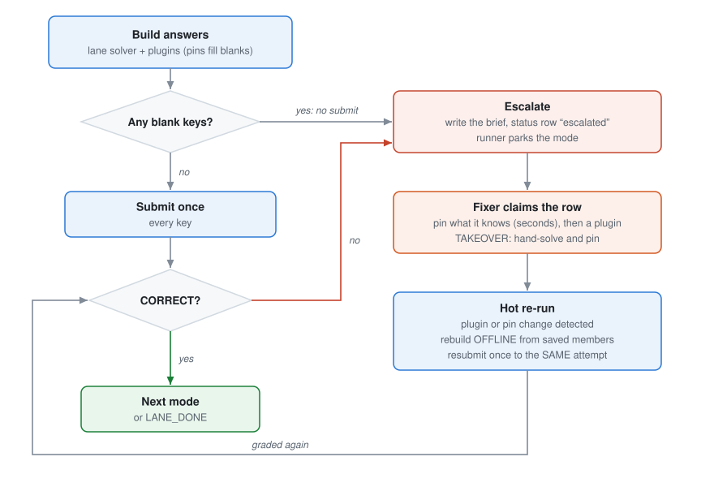
</picture>

The solver gets one clean submit. Everything after a miss is aimed at changing the pin file or a plugin as fast as possible, because that change is what triggers the re-run. When a pin solved a mode and no plugin exists yet, the runner prints `PLUGIN_FIRST`: the plugin is owed before the next mode starts. The TAKEOVER rule fires when the same key is wrong after 2 installs, 5 minutes after an escalation, or when the fixer can't explain the gap within 2 minutes.

Lessons that shaped this loop:

- Blank keys are a real problem, not a guess to send: escalate before any submit.

- Probing wrong keys one by one against the grader costs calls and minutes; when a new format leaves hundreds of keys blank, hand the whole list to the fixer instead.

- A resubmit goes to the attempt that is already running. Starting a fresh attempt throws away the artifact and, on timed modes, the clock.

`race/runner.py` park — watch for a fix, rebuild offline, resubmit once

```
        seen = (plugins.stamp(lane.name, self.s), pins.stamp(self.day, lane.name, self.s))
        t_end = time.time() + self.s.park_s
        while time.time() < t_end:
            time.sleep(0.5)
            now = (plugins.stamp(lane.name, self.s), pins.stamp(self.day, lane.name, self.s))
            if now == seen:
                continue
            seen = now
            # ...
            ans, prov = self.build(lane, mode, qs, members, live=False)        # offline: saved members only
            missing = [q["id"] for q in qs if ans.get(q["id"]) in BLANK]
            # ...
            if ans == sent:
                self.note(lane.name, mode, "hot re-run: answers unchanged, not resubmitting")
                continue
            # ...
            sent = ans
            r = gm.submit(cidm, ans, deadline=st.get("deadline"))
```

`race/pins.py` — live tries only fill blanks; offline re-runs overlay

```
def overlay(answers, pins, qids=None):
    out = dict(answers)
    for k, v in pins.items():
        if qids is None or k in qids:
            out[k] = v
    return out


def fill_blank(answers, pins, qids=None):
    out = dict(answers)
    for k, v in pins.items():
        if (qids is None or k in qids) and out.get(k) in BLANK:
            out[k] = v
    return out
```

### 4 · Overlapping waits

Two network waits dominated the first seconds of a race, and both were fixed by overlapping calls, not by faster code:

- **Unlock detection.** The server answers slowly right at the unlock, so one blocking list call at a time can see the day many seconds late. A hedged poll starts a new list call every ~0.25 s near the unlock, keeps up to three in flight on separate connections, and takes the first answer. One in-flight call almost always straddles the unlock.

- **Mastery downloads.** Fetching mastery deliveries one after another costs the sum of their times; fetching them on parallel threads costs roughly the slowest one, and each delivery can start building as soon as its bytes land.

<picture>
  <source media="(prefers-color-scheme: dark)" srcset="docs/img/overlap-dark.svg">
  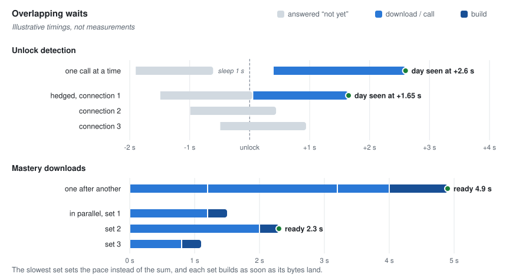
</picture>

The shared pacer in `race/gm.py` is what makes this safe: several processes can overlap calls without tripping the server's lockout. This skeleton keeps the simple versions (`Runner.wait_unlock` polls once a second, `Lane.fetch` downloads in order); both are the first places to add overlap.

### 5 · Patterns that made lanes fast

Every lane shares the runner, but each kind of challenge has its own bottleneck. These patterns go in lane solvers and plugins; the lane skill (`.claude/skills/lane-<lane>/`) records the recipes.

**Encoded-text lanes**

<picture>
  <source media="(prefers-color-scheme: dark)" srcset="docs/img/lane-encoded-dark.svg">
  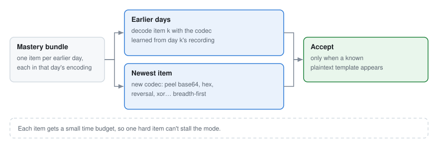
</picture>

1. A mastery bundle can stack one item per earlier day, each in that day's encoding. Keep every day's recording and decode item k with the codec learned from day k's own run instead of guessing.

2. Only the newest item uses a new codec. Peel it layer by layer (base64, hex, reversal, xor and similar), breadth-first.

3. Accept a decode only when a known plaintext template appears, and give each item a small time budget so one hard item can't stall the mode.

**Script-analysis lanes**

<picture>
  <source media="(prefers-color-scheme: dark)" srcset="docs/img/lane-script-dark.svg">
  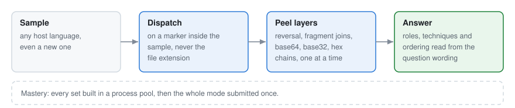
</picture>

1. Dispatch on a marker embedded in the sample, not the file extension, so a new host language works the day it first appears.

2. Peel layered payloads (reversal, fragment joins, base64, base32, hex chains) one at a time until readable script comes out.

3. Read rules (roles, techniques, ordering) from the question wording instead of a fixed key list.

4. Build mastery sets in a process pool and submit the whole mode once.

**File-metadata lanes**

<picture>
  <source media="(prefers-color-scheme: dark)" srcset="docs/img/lane-metadata-dark.svg">
  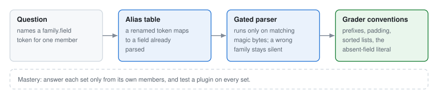
</picture>

1. Each question names a `family.field` token for one member. An alias table maps renamed tokens to fields already parsed, so a rename is not a new format.

2. Gate each parser on the member's magic bytes, so a parser for the wrong family stays silent. This is also what makes forecasts safe: a wrong forecast never answers.

3. Follow the grader's conventions exactly (prefixes, padding, sorted lists, the literal for an absent field).

4. Answer each mastery set only from its own members, and test a plugin on every set, not just the first.

**Mobile-app lanes**

<picture>
  <source media="(prefers-color-scheme: dark)" srcset="docs/img/lane-mobile-dark.svg">
  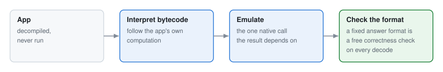
</picture>

1. A fixed answer format is a free correctness check on every decode.

2. When the answer is computed by the app, interpret its decompiled bytecode and emulate the one native call; never run the app.

**Binary lanes**

<picture>
  <source media="(prefers-color-scheme: dark)" srcset="docs/img/lane-binary-dark.svg">
  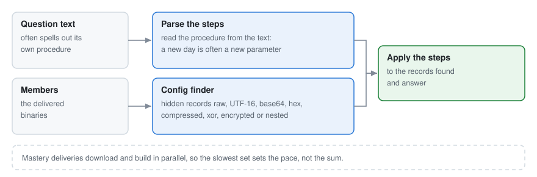
</picture>

1. Questions often spell out their own procedure. Parse the steps from the text, so a new day is often a new parameter, not new code.

2. One finder for hidden config records in any storage form (raw, UTF-16, base64, hex, compressed, xor, encrypted, nested archives).

3. Download and build mastery deliveries in parallel, so the slowest set sets the pace instead of the sum.

**Live-target lanes (web)**

<picture>
  <source media="(prefers-color-scheme: dark)" srcset="docs/img/lane-web-dark.svg">
  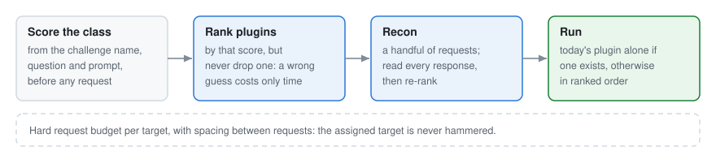
</picture>

1. Score the likely vulnerability class from the challenge's own name, question and prompt before any request.

2. Rank candidate plugins by that score but never drop one: a wrong guess costs time, not the solve.

3. Send a handful of recon requests, then re-rank. When a plugin written for today exists, run it alone.

4. Hold a hard request budget per target with spacing between requests, so the assigned target is never hammered.

5. Read what the server tells you: a `Vary` header can name the header that grants access.

`plugins/_template.py` — narrow on purpose: answer what you understand, None for the rest

```
WANT = re.compile(r"replace with a pattern that matches the questions this plugin answers")


def answer(q, ctx):
    if not WANT.search(q.get("question", "")):
        return None
    files = ctx.for_qid(q["id"])
    # ... compute from the bytes in `files` (read only; never execute a member) ...
    return None
```

### 6 · Each race makes the next one colder

<picture>
  <source media="(prefers-color-scheme: dark)" srcset="docs/img/cycle-dark.svg">
  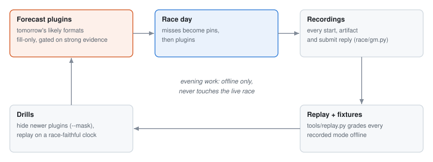
</picture>

The evening work never touches the live race. Recordings let every fix be tested offline against every earlier day and give drills their material; drills train the lane skills with the newer plugins hidden. The payoff is a forecast written the night before that answers a brand-new format with no fixer at all.

`race/plugins.py` load\_one — the only import path, so the mask can't be bypassed

```
def load_one(stem, s=None):
    if stem in masked():
        raise Masked(f"plugin {stem} is masked (RACE_PLUGIN_EXCLUDE)")
    p = os.path.join(_dir(s), stem + ".py")
    mt = os.stat(p).st_mtime_ns
    hit = _CACHE.get(p)
    if hit and hit[0] == mt:
        return hit[1]
    with open(p, "rb") as f:
        code = compile(f.read(), p, "exec")       # from source every time: the .pyc cache keys on whole-second
    spec = importlib.util.spec_from_file_location(f"race_plugin_{stem}", p)   # mtime + size and can go stale
    mod = importlib.util.module_from_spec(spec)
    exec(code, mod.__dict__)
    _CACHE[p] = (mt, mod)
    return mod
```

### Small mechanisms that carried a lot

- **Pins as the handoff contract.** Fixers never submit for a file lane. They write `qid=value` pairs; the runner owns every submit, so there are no double submits or stray attempts.

- **Atomic claims.** A row is claimed with a lock, so two sessions never work the same row.

- **Turning a plugin off.** Settings are read when the runner starts, so an environment switch can't be flipped mid-race. Moving the plugin out of `plugins/` can; the runner notices.

- **Fail-safe watchdog.** It reads only local files and flags stalls, quiet fixers and deadline risk without spending Game Master calls.
